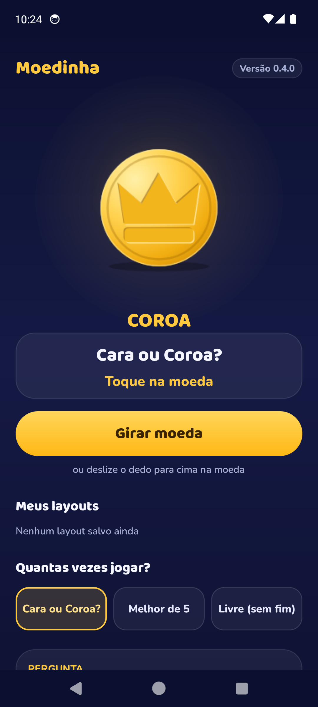
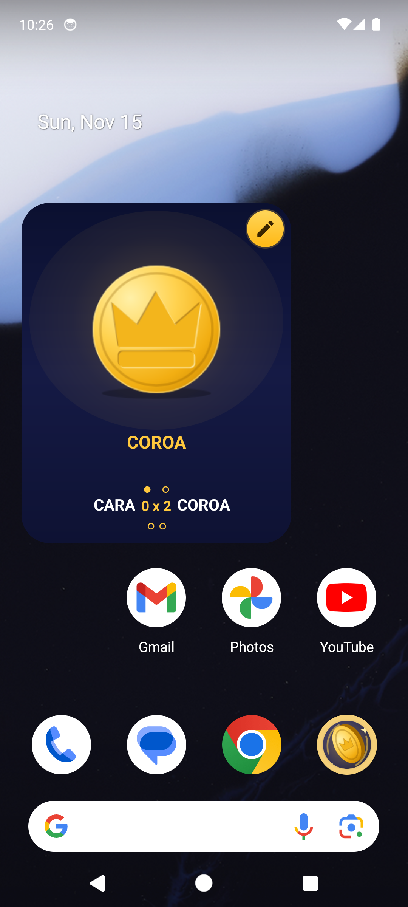
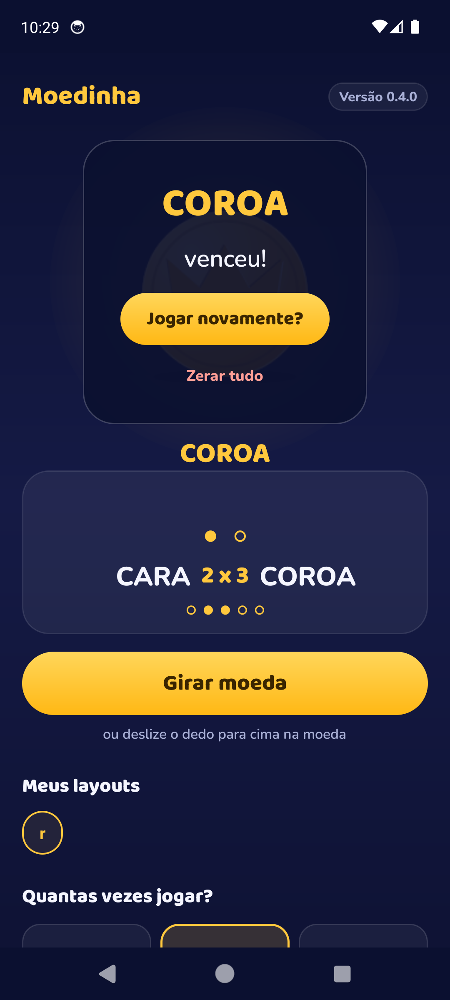
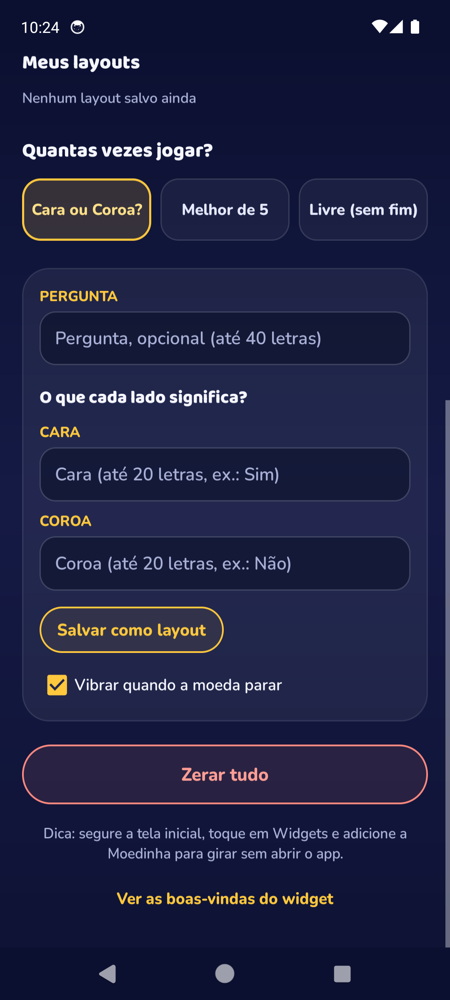
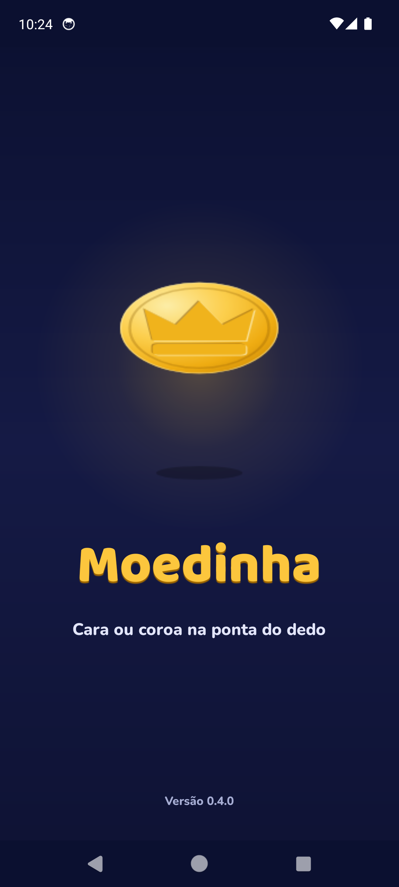
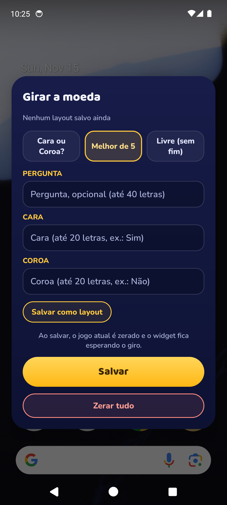

<div align="center">

# 🪙 Moedinha

**Cara ou coroa na ponta do dedo. Gire a moeda direto da tela inicial.**

[](https://deverasrenato.github.io/cara-ou-coroa/)


 &nbsp;  &nbsp; 

</div>

## 👉 Teste agora, sem instalar nada
**[https://deverasrenato.github.io/cara-ou-coroa/](https://deverasrenato.github.io/cara-ou-coroa/)**

Abre uma simulação clicável no navegador, com dois celulares lado a lado: toque no ícone da **Moedinha** para abrir o app e toque na moeda do **widget** para girar sem abrir o app. (É uma recriação em página web; o app de verdade é nativo para Android.)

## Sobre o app
App de cara ou coroa para Android, chamado **Moedinha** (a pasta e o repositório continuam `cara-ou-coroa`). O diferencial é o widget: o usuário toca nele, a moeda gira com animação e o resultado aparece, sem precisar abrir o app.

Projeto acadêmico de Análise e Desenvolvimento de Sistemas (ADS), desenvolvido em Kotlin com o Android Studio. Somente Android.

> **Status:** em desenvolvimento (MVP), versão **0.5.0**. O app compila, gera o APK de teste e funciona no emulador e em um celular de verdade (o visual novo ainda está sendo conferido). Veja o [Roadmap](#roadmap).

## Telas
<div align="center">

| Abertura | Boas-vindas | Janelinha do lápis |
|:---:|:---:|:---:|
|  |  |  |

<sub>Capturas do emulador Android, versão 0.4.0 (a 0.5.0 acrescenta "Meus layouts").</sub>

</div>

## Como o app funciona
1. O usuário abre o app e toca na moeda (ou no botão "Girar moeda"): a moeda gira e mostra CARA (silhueta de uma pessoa) ou COROA (uma coroa), em relevo.
2. Ao abrir, aparece uma abertura com a moeda girando e, na primeira vez, as boas-vindas ensinando a adicionar o widget (dá para escolher ver sempre ou rever pela tela principal). O usuário adiciona o widget à tela inicial (segurar a tela, Widgets, Moedinha).
3. Tocando na moeda do widget, ela gira com animação e o resultado aparece ali mesmo.
4. Para decidir algo específico, o usuário toca no lápis do widget e digita (tudo opcional) a pergunta e o que significa cara e coroa. Exemplo: "Pedir delivery?", cara = "Sim", coroa = "Não". A moeda para em CARA e, embaixo dela, aparece:

```
Pedir delivery?
Sim
```

5. O usuário escolhe o modo marcando uma opção: **Cara ou Coroa?** (padrão, um giro só), **Melhor de 5** ou **Livre (sem fim)** (conta cara e coroa até o app sair da tela). Trocar de modo começa um jogo novo na hora. Cada toque na moeda é um giro (no app, deslizar o dedo para cima na moeda também gira). Depois do giro, o nome do lado que saiu (CARA ou COROA) aparece embaixo da moeda. Nos modos com placar, o cartão abaixo da moeda tem linhas fixas e centralizadas: a pergunta, o placar (com ● para o lado da cara e ○ para o lado da coroa em cima dos números) e o que saiu em cada giro:

```
Pedir delivery?
         ●   ○
Sim     2 x 1     Não
● ○ ●
```

6. Quando um lado ganha a série (3 vitórias na melhor de 5), o vencedor aparece sobre a moeda, em um balão escuro translúcido, com o botão **"Jogar novamente?"** e, abaixo, um "Zerar tudo" pequeno (com confirmação). Os giros que sobrariam não são jogados. Tocar na moeda com o balão aberto também começa um jogo novo e já gira.
7. Na janelinha do lápis, o botão **"Salvar"** começa um jogo novo: o widget volta zerado, mostra a pergunta e espera o toque na moeda.
8. **Meus layouts:** o usuário pode salvar até 5 conjuntos prontos (nome, modo, pergunta e textos de cara e coroa) com "Salvar como layout". Tocar em um layout, no app ou na janelinha do lápis, configura tudo de uma vez e deixa o widget esperando o giro. Segurar o dedo em um layout apaga (com confirmação).
9. **"Zerar tudo"** (no app e na janelinha do lápis, com confirmação) apaga placar, pergunta e textos e volta ao modo "Cara ou Coroa?".
10. A moeda vibra quando para (dá para desligar no app). Limites de texto: 20 letras para cara e coroa, 40 para a pergunta. O app e o widget guardam o mesmo estado e mostram sempre o mesmo.

## Demonstração online
Uma simulação clicável do app roda em uma página web (pasta `docs/demo`), para quem não tem Android ver como funciona. Aparecem dois celulares lado a lado: a tela inicial com o widget e o app, que abre ao tocar no ícone da Moedinha. Dá para ver: abertura, boas-vindas, os 3 modos, placar, vencedor, widget, janelinha do lápis e "Meus layouts" (salvar, escolher e apagar). O endereço é [deverasrenato.github.io/cara-ou-coroa](https://deverasrenato.github.io/cara-ou-coroa/) (GitHub Pages, fonte `main`, pasta `/docs`). É uma recriação em JavaScript, não o app de verdade.

## Tecnologias
- [Kotlin](https://kotlinlang.org) e o [Android Studio](https://developer.android.com/studio)
- Layouts em XML (telas tradicionais do Android, sem bibliotecas extras além do AndroidX)
- App Widget (`AppWidgetProvider` e `RemoteViews`) para o widget da tela inicial
- Fontes [Baloo 2](https://fonts.google.com/specimen/Baloo+2) e [Nunito](https://fonts.google.com/specimen/Nunito) dentro do app (licença OFL; o widget usa a fonte do sistema)

A moeda é desenhada por código (`Canvas`), sem imagens prontas (a cara é a silhueta de uma pessoa e a coroa é uma coroa, em relevo). O código usa nomes em inglês e **comentários em português**, com o objetivo de ser simples e didático.

## Como rodar o projeto
**Pré-requisitos:** [Android Studio](https://developer.android.com/studio) (ele já traz o Java e o SDK do Android) e [Git](https://git-scm.com).

```bash
git clone https://github.com/deverasrenato/cara-ou-coroa.git
```

1. Abra a pasta `cara-ou-coroa` no Android Studio e espere o Gradle sincronizar (na primeira vez demora e baixa bastante coisa).
2. Rode no celular (com a depuração USB ligada) ou no emulador, pelo botão ▶.
3. Para testar o widget: segure a tela inicial, toque em **Widgets**, procure "Moedinha" e arraste para a tela.

> Dica: não coloque a pasta do projeto dentro do Google Drive ou do OneDrive. Use `C:\dev`.

## Gerar o APK (instalador para Android)
No Android Studio: **Build > Build Bundle(s) / APK(s) > Build APK(s)**. Ou, pelo terminal (com `JAVA_HOME` e `ANDROID_HOME` definidos):

```bash
.\gradlew.bat assembleDebug
```

O arquivo fica em `app/build/outputs/apk/debug/app-debug.apk`. Para instalar no celular, permita a instalação de fontes desconhecidas.

## Estrutura de pastas
```
cara-ou-coroa/
├── app/
│   └── src/main/
│       ├── java/com/deverasrenato/caraoucoroa/   # código Kotlin
│       │   ├── Coin.kt                # desenha a moeda e a animação
│       │   ├── CoinStore.kt           # guarda o estado do jogo (placar, textos, modo)
│       │   ├── CoinWidgetProvider.kt  # o widget
│       │   ├── QuickFlipActivity.kt   # a janelinha do lápis do widget
│       │   ├── ConfirmResetActivity.kt # a confirmação "Zerar tudo?" aberta pelo widget
│       │   ├── Presets.kt             # os layouts salvos (até 5)
│       │   ├── SplashActivity.kt      # a abertura (moeda girando)
│       │   ├── WelcomeActivity.kt     # boas-vindas: como adicionar o widget
│       │   └── MainActivity.kt        # a tela do app
│       ├── res/                       # layouts, textos, cores, fontes e ícone
│       └── AndroidManifest.xml
├── docs/           # requisitos, plano de execução, decisões, versões e licenças das fontes
├── build.gradle.kts, settings.gradle.kts, gradle.properties
└── CLAUDE.md       # contexto para o Claude Code
```

## Documentação
- [`docs/requisitos.md`](docs/requisitos.md): requisitos, histórias de usuário e regras de negócio.
- [`docs/plano-de-execucao.md`](docs/plano-de-execucao.md): estado atual, etapas e como retomar em outro computador.
- [`docs/decisoes.md`](docs/decisoes.md): histórico e registro das decisões, com o fundamento de cada uma.
- [`docs/versoes.md`](docs/versoes.md): o que cada versão trouxe.
- [`docs/publicacao.md`](docs/publicacao.md): o que falta para publicar na Google Play.

## Roadmap
**Já existe no código (compila; ainda não testado no celular):**
- [x] Moeda desenhada por código, com giro, subida e sombra
- [x] Tela do app com botão "Girar moeda"
- [x] Widget (padrão 3x3) que gira ao toque
- [x] Último resultado compartilhado entre o app e o widget
- [x] Textos de cara e coroa e pergunta opcional (no app e na janelinha do widget)
- [x] Modos "Cara ou Coroa?", "Melhor de 5" e livre, com placar e sequência
- [x] Vencedor sobre a moeda, "Jogar novamente?" e "Zerar tudo"
- [x] Janelinha com "Salvar", vibração (com opção de desligar) e número da versão
- [x] Novo visual: nome Moedinha, meia-noite e ouro, moeda em relevo sem texto, ícone novo e fontes Baloo 2 e Nunito (licença OFL, em `docs/`)
- [x] Abertura com a moeda girando e boas-vindas que ensinam a adicionar o widget
- [x] Layouts salvos: até 5 conjuntos de modo, pergunta e textos, escolhidos com um toque

**Próximos passos:**
- [x] Compilar (APK de teste gerado por linha de comando)
- [x] Testar no emulador (app e widget funcionando)
- [ ] Testar em celular de verdade
- [ ] Ajustar a fluidez da animação do widget
- [ ] Conferir o novo visual no widget e no celular de verdade
- [ ] Som ao girar (opcional)
- [ ] APK de teste

**Caminho até a Play Store** (detalhes em [`docs/publicacao.md`](docs/publicacao.md)):
- [ ] **A.** Fechar o MVP: testes por toque no emulador e no S23
- [ ] **B.** Tela "Sobre o desenvolvedor" (apresentação e links de perfil), versão 0.6.0
- [ ] **C.** Preparar a publicação: nome e `applicationId` definitivos, `targetSdk` 36, AAB assinado, política de privacidade e ficha da loja
- [ ] **D.** Conta na Play (US$ 25), teste fechado (12 testadores por 14 dias) e produção, versão 1.0.0
- [ ] **E.** "Doe um café" pelo Google Play Billing, depois de publicado

## Privacidade
Nenhum dado sai do aparelho. O app guarda apenas o estado do jogo (resultado, placar, pergunta e textos) no próprio celular, e não usa internet. A única permissão é a de vibrar, concedida pelo Android sem perguntar. O widget não roda nada em segundo plano: só trabalha por cerca de 1,3 segundo quando o usuário toca.

## Versão
Versão atual: **0.5.0**. O histórico de versões está em [`docs/versoes.md`](docs/versoes.md).

## Licença
**Copyright (c) 2026 Renato Veras. Todos os direitos reservados.** O texto completo está em [`LICENSE`](LICENSE), em inglês, com a tradução em português ao final.

---

Desenvolvido por **Renato Veras**, estudante de ADS.
